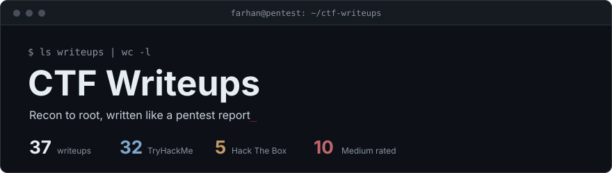
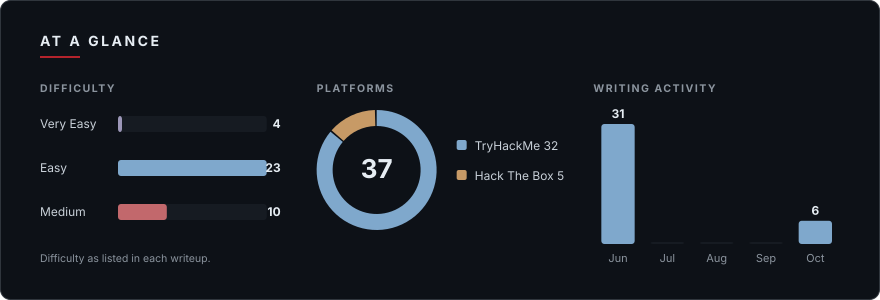
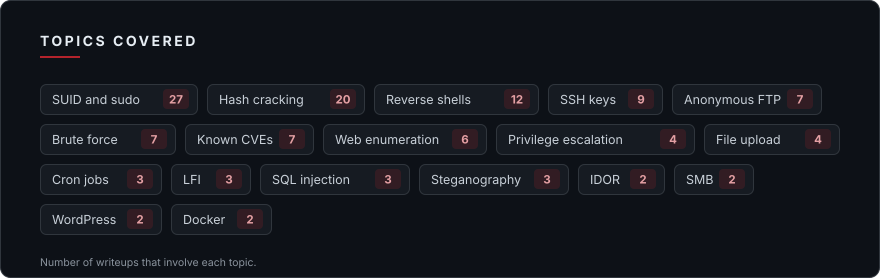

  

Every writeup here is written the way I would hand it over in an engagement: how I found the target, how I got in, how I escalated, how the issue should be fixed, and what I would do faster next time. Platforms are TryHackMe and Hack The Box. All targets are retired machines or training rooms on legal lab platforms.

  

  

## Start here

If you only read three, read these. Each one shows a different part of how I work.

- **[Mr Robot CTF](TryHackme/mrrobot_writeup.md)**: a wordlist cut from 858,160 entries to 11,451 made Hydra 75 times faster, with no loss of coverage.
- **[Mustacchio](TryHackme/mustacchio_writeup.md)**: XXE on an XML endpoint that turns the parser into a file reader.
- **[Archetype](HackTheBox/archetype_writeup.md)**: a Windows foothold through plaintext credentials in an SSIS config file and PowerShell history.

## What every writeup contains

| Section | What you get |
|---|---|
| **TL;DR** | The full attack chain in a few sentences. |
| **Recon and foothold** | Scans, enumeration and the first weakness found. |
| **Shell and escalation** | How access became root or SYSTEM. |
| **Rabbit holes** | Dead ends, and why they were dead ends. |
| **Mitigations** | How each issue should be fixed. |
| **Key takeaway** | The one lesson worth keeping, plus "if I did it again". |

## Hack The Box

| Machine | Level | Foothold | Escalation | Key takeaway |
|---|---|---|---|---|
| [Archetype](HackTheBox/archetype_writeup.md) |  | Open SMB share leaks SQL Server credentials | `xp_cmdshell` reverse shell, then admin password in PowerShell history | `ConsoleHost_history.txt` is the Windows equivalent of `.bash_history` — and people are far less likely… |
| [Cap](HackTheBox/cap_writeup.md) |  | IDOR on `/data/<id>` exposes a PCAP with FTP credentials | `python3.8` with the `cap_setuid` capability | Linux capabilities are quieter than SUID bits and just as dangerous. |
| [Oopsie](HackTheBox/oopsie_writeup.md) |  | Cookie IDOR reaches the admin upload form, PHP shell | Credentials in `db.php`, SUID binary hijacked through `PATH` | Authorization in web applications has to live on the server — never in a cookie the user controls. |
| [Unified](HackTheBox/unified_writeup.md) |  | Log4Shell (CVE-2021-44228) on UniFi 6.4.54 | Unauthenticated MongoDB admin hash swap, root SSH credentials in settings | Log4Shell is the cleanest example of why logging user-controlled input without sanitization is… |
| [Vaccine](HackTheBox/vaccine_writeup.md) |  | Anonymous FTP ZIP, cracked hashes, SQL injection with `sqlmap --os-shell` | `sudo vi` GTFOBins escape | This box is a clean demonstration of credential chaining: each service exposes just enough information… |

## TryHackMe

| Machine | Level | Foothold | Escalation | Key takeaway |
|---|---|---|---|---|
| [0day](TryHackme/0day_writeup.md) |  | Exposed SSH key and Shellshock through a CGI script | Kernel exploit CVE-2015-1328 (OverlayFS) | A `cgi-bin` directory on any server running a pre-2014 Bash is a Shellshock waiting to happen — always… |
| [Anonforce](TryHackme/anonforce_writeup.md) |  | Anonymous FTP serves the whole filesystem | GPG-protected shadow backup cracked with John and Hashcat | Anonymous FTP is almost never appropriate for production systems — but it's especially catastrophic when… |
| [Anonymous](TryHackme/anonymous_writeup.md) |  | Writable FTP scripts directory overwritten with a reverse shell | SUID `env` GTFOBins escape | A growing log file with repeated identical entries is direct evidence of a scheduled task — and a… |
| [Basic Pentesting](TryHackme/basicpentesting_writeup.md) |  | SMB enumeration with `enum4linux`, Hydra against SSH | Readable SSH key, passphrase cracked with John, pivot to a second user | A security audit that identifies a weak password but doesn't enforce remediation, combined with home… |
| [Billing](TryHackme/billing_writeup.md) |  | Command injection in MagnusBilling `icepay.php` | `sudo fail2ban-client` with a custom ban action | Granting `sudo` access to a tool's *client* binary is not the same as granting access to only its "safe"… |
| [Blog](TryHackme/blog_writeup.md) |  | WordPress 5.0 crop-image RCE (CVE-2019-8942) | SUID `checker` abused through an environment variable | Environment variables are entirely user-controlled — any user can set `admin=1` before running a command. |
| [Boiler CTF](TryHackme/boilerctf_writeup.md) |  | Joomla test script command injection, anonymous FTP | Credentials in a backup script, SUID `find` | Not every encoded string or elaborate puzzle is a critical clue — sometimes the box is testing whether… |
| [Bounty Hacker](TryHackme/bountyhacker_writeup.md) |  | Anonymous FTP wordlist, Hydra against SSH | `sudo tar` checkpoint-action | GTFOBins is not just a list of fun tricks — it's a mandatory pre-flight checklist before granting `sudo`… |
| [Brooklyn Nine-Nine](TryHackme/brooklynninenine_writeup.md) |  | Anonymous FTP hint, steganography cracked with `stegseek` | `sudo less` GTFOBins escape | A correct password attached to a guessed username is indistinguishable from a wrong password until you… |
| [Brute It](TryHackme/bruteit_writeup.md) |  | Hydra on the admin panel, encrypted SSH key cracked | `sudo cat` reads `/etc/shadow`, root hash cracked | `sudo cat` is not a safe alternative to `sudo vim` or `sudo bash` — the ability to read any file as root… |
| [Chill Hack](TryHackme/chillhack_writeup.md) |  | Command filter bypass with `find -exec`, steghide ZIP | Writable Docker socket, host filesystem mounted | Access to the Docker socket is equivalent to root access on the host — there is no meaningful… |
| [Cyber Heroes](TryHackme/cyberheros_writeup.md) |  | Credentials hardcoded in client-side JavaScript | None needed | Anything that runs in the browser is readable by the user — no amount of string reversal, obfuscation… |
| [Cyborg](TryHackme/cyborg_writeup.md) |  | Exposed Squid config, cracked hash, BorgBackup archive | `sudo` backup script command injection | Credential reuse across services is a force multiplier for attackers — one cracked hash unlocked both… |
| [Fowsniff CTF](TryHackme/fowsniff_writeup.md) |  | Leaked MD5 dump found through OSINT, POP3 inbox | World-writable script run as root on SSH login | OSINT isn't just a pre-engagement formality — sometimes it hands you the entire credential set before… |
| [Ignite](TryHackme/ignite_writeup.md) |  | Fuel CMS 1.4.1 RCE (CVE-2018-16763) | MySQL password reused as the root password | When a discovered credential fails against `sudo`, try it against `su` before discarding it — the two… |
| [Lian Yu](TryHackme/lianyu_writeup.md) |  | Custom extension discovery with Feroxbuster, steghide | `sudo pkexec` | Enumeration isn't just running the same tools with the same flags every time — Lian Yu's key step was… |
| [Mr Robot CTF](TryHackme/mrrobot_writeup.md) |  | `robots.txt` wordlist, Hydra, WordPress theme editor shell | SUID `nmap` interactive mode | Always deduplicate custom wordlists before feeding them to Hydra — 858,160 entries shrunk to 11,451 is a… |
| [Mustacchio](TryHackme/mustacchio_writeup.md) |  | Exposed SQLite backup, XXE reads an SSH key | SUID binary hijacked through `PATH` | XXE is not just an academic vulnerability — when a web application parses XML and reflects the output, a… |
| [Neighbour](TryHackme/neighbour_writeup.md) |  | Guest credentials in an HTML comment, IDOR on `?user=` | None needed | A session cookie proves you're *logged in* — it doesn't automatically prove you're allowed to access… |
| [Overpass](TryHackme/overpass_writeup.md) |  | Client-side auth bypass with a forged cookie, SSH key cracked | Root cron job running `curl | bash` with a writable `/etc/hosts` | Broken authentication doesn't need to be subtle to be devastating — here it was "the server trusts a… |
| [Pickle Rick](TryHackme/picklerick_writeup.md) |  | Credentials in a comment and `robots.txt`, command panel | None needed, all flags read through the panel | A command filter is only as strong as its list is complete — blocking `cat` while leaving `less`… |
| [Publisher](TryHackme/publisher_writeup.md) |  | SSH access with a leaked key | SUID `run_container` plus an AppArmor profile bypass | AppArmor profiles are only as strong as their coverage — a profile that restricts `ash` but doesn't… |
| [Red](TryHackme/red_writeup.md) |  | LFI through `php://filter`, hashcat rules on a leaked password | Lateral move past a hostile user, SUID `pkexec` (PwnKit attempt) | A sanitization function that only runs once is functionally the same as no sanitization at all — always… |
| [RootMe](TryHackme/rootme_writeup.md) |  | File upload filter bypass with `.phtml` | SUID `python2.7` | When reviewing SUID binaries, the question isn't "do I recognise this binary" — it's "should this binary… |
| [Silver Platter](TryHackme/silverplatter_writeup.md) |  | CeWL wordlist and Hydra, Silverpeas IDOR | Password in `adm` group logs, `sudo su` | Passwords passed as command-line arguments are logged everywhere — `sudo` audit logs, shell history… |
| [Simple CTF](TryHackme/simplectf_writeup.md) |  | CMS Made Simple SQL injection (CVE-2019-9053) | `sudo vim` | Granting `sudo` access to any program that can run arbitrary commands — editors, interpreters, pagers… |
| [Source](TryHackme/source_writeup.md) |  | Webmin 1.890 backdoor (CVE-2019-15107) | None, root on the first shell | Supply-chain attacks are particularly insidious because they subvert trust at the source — downloading… |
| [Team](TryHackme/team_writeup.md) |  | `robots.txt` username, FTP credentials, LFI reads an SSH key | `sudo` script injection, writable root cron script | Virtual host enumeration is an underused but essential step — the entire attack surface of this box was… |
| [tomghost](TryHackme/tomghost_writeup.md) |  | Ghostcat AJP file read (CVE-2020-1938) | GPG key cracked, `sudo zip` | Always check exposed protocols, not just the headline application version — Ghostcat is a… |
| [w1seGuy](TryHackme/w1seguy_writeup.md) |  | XOR known-plaintext attack recovers the key | Crypto challenge, no escalation | XOR is not encryption — it is a bitwise operation. |
| [Watcher](TryHackme/watcher_writeup.md) |  | LFI to FTP credentials, shell upload | Six hops: `sudo php`, writable cron, writable Python module, RSA key in backups | Python's import resolution searches the script's local directory before system paths. |
| [Wgel CTF](TryHackme/wgel_writeup.md) |  | SSH key in a browsable `.ssh` directory | `sudo wget` reads any file as root | `sudo wget` is not "just a download tool" — `--post-file` turns it into a root-powered file exfiltration… |

---

  Last updated: 2 November 2026 &nbsp;|&nbsp; Profile: <a href="https://github.com/thecyberfarhan">github.com/thecyberfarhan</a>

